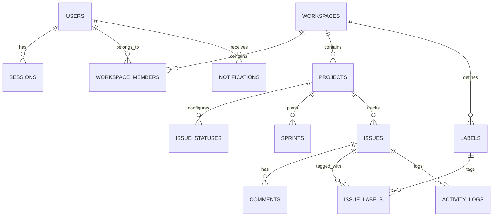

# RustTrack Architecture & Design

RustTrack is architected as a modular monolith balancing high developer velocity, extreme runtime efficiency, and clean domain isolation.

## Architectural Principles

1. **Modular Monolith over Microservices**: Single deployable binary for the backend, eliminating distributed transaction overhead, network latency, and operational sprawl.
2. **Explicit Domain Boundaries**: Code is grouped into cohesive domain modules:
   - `auth`: Registration, session lifecycle, password reset, Argon2id security.
   - `workspaces`: Multi-tenant boundary, organization lifecycle, workspace settings.
   - `members`: Workspace roles (Owner, Admin, Member, Viewer), invitations.
   - `projects`: Project spaces, project keys (e.g. `PROJ`), issue counter sequencing.
   - `workflows`: Issue status categories (Backlog, Todo, InProgress, InReview, Done) and transitions.
   - `issues`: Issue CRUD, types (Task, Bug, Story, Epic), priorities, assignments, parent-child links.
   - `comments`: Discussion threads on issues.
   - `labels`: Workspace-scoped tags with custom colors.
   - `sprints`: Agile planning, backlog organization, sprint lifecycle.
   - `notifications`: In-app notification triggers and unread counters.
   - `audit`: Immutable activity tracking for project and issue events.
3. **Tenant Isolation**: Every database interaction enforces the workspace boundary. Client requests are never trusted regarding tenant access; access is verified against authenticated session state.
4. **Strong Typing & Safety**: SQLx provides compile-time query verification and parameterized execution preventing SQL injection. Serde and Zod guarantee strict contract serialization.

## Backend Layers

- **Routes / Handlers**: Thin Axum handlers deserializing input, applying auth extractors, invoking domain services, and returning structured responses.
- **Extractors & Middleware**: Authenticated user extractor, workspace permission guard, rate limiting, request tracing, CORS, security headers.
- **Domain Services**: Business logic, status state transitions, atomic issue number generation, notification dispatch.
- **Repositories**: Direct SQLx queries using Postgres connection pools.
- **Database Migrations**: Versioned SQL files managed by SQLx migrations.

## Database Schema Model

## Concurrency & Data Integrity

- **Per-Project Issue Numbers**: Generated inside transactions with `UPDATE projects SET issue_counter = issue_counter + 1 WHERE id = $1 RETURNING issue_counter`. This guarantees gapless, collision-free human identifiers (e.g., `APP-101`) even under heavy concurrent load.
- **Kanban Order**: Manual ordering uses numeric `position` floating coordinates or dense indexing updated via reorder requests.
- **Optimistic Concurrency**: Issues track `updated_at` timestamps to reject stale edits and prevent conflicting overrides.
