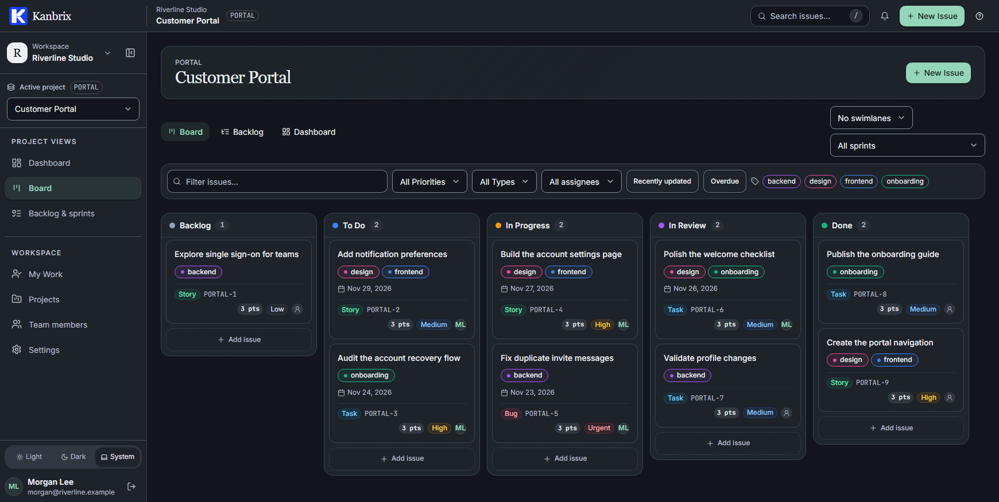

# Import Jira issues into Kanbrix

Try the migration with one project first. Kanbrix previews the issues and lets you map Jira statuses to the columns on your destination board.

## Preview and import

1. [Install Kanbrix](INSTALL-KANBRIX.md) and sign in as a workspace owner or admin.
2. Open **Settings → Integrations** and choose **Jira**. You can also use **CSV / JSON File** if you have an issue export.
3. For a direct connection, enter your Jira site URL and credentials for an account that can read the source issues. Preview the project before importing.
4. Choose the destination project and match each source status to a Kanbrix workflow column. Map the completed statuses to a Done column.
5. Run the import, review the created, updated, and skipped counts, then open the board and check a few representative issues. Download the import report if you need to review the outcome with your team.

## Check what transferred

Jira rich-text descriptions transfer as plain text. Jira preview fetches up to 10,000 issues, subject to the request size limit. For an import you plan to repeat, use the same destination project and keep the original issue keys. Kanbrix uses source IDs to update previous imports in that project.

[Kanbrix integration documentation](https://github.com/toozuuu/kanbrix#syncing-from-jira-github-linear--git-webhooks)
